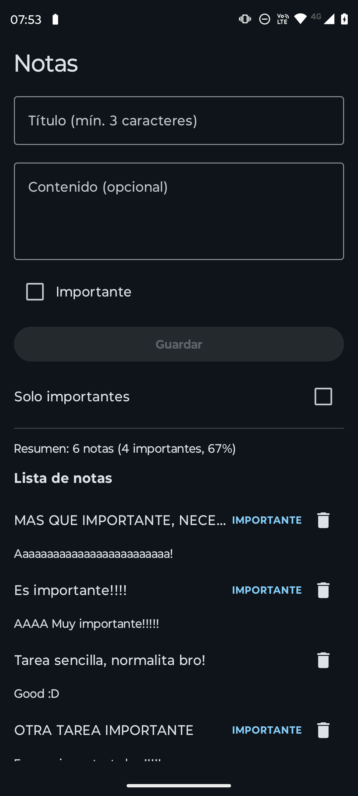
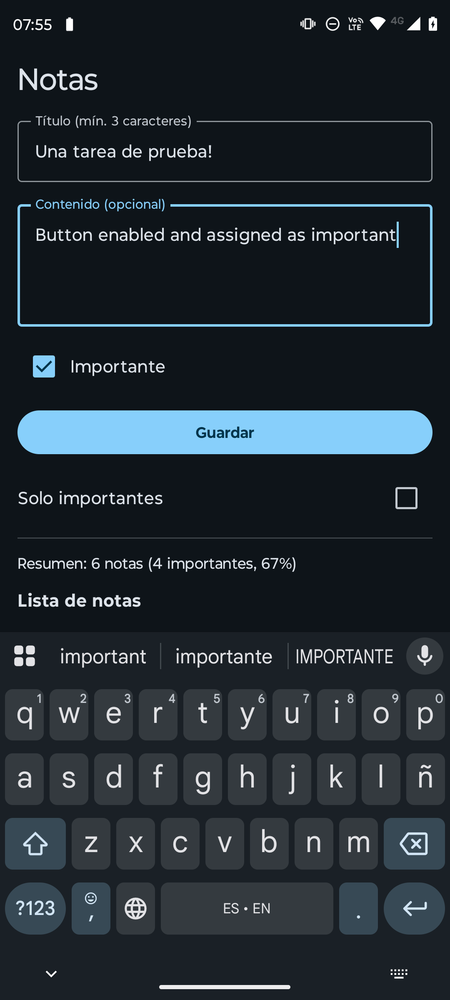
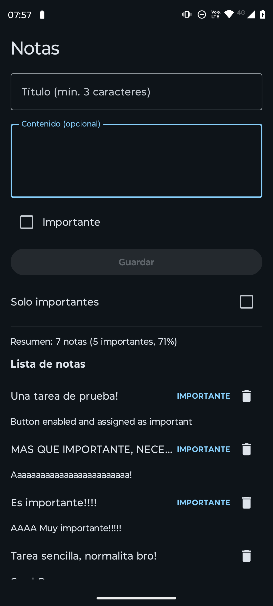
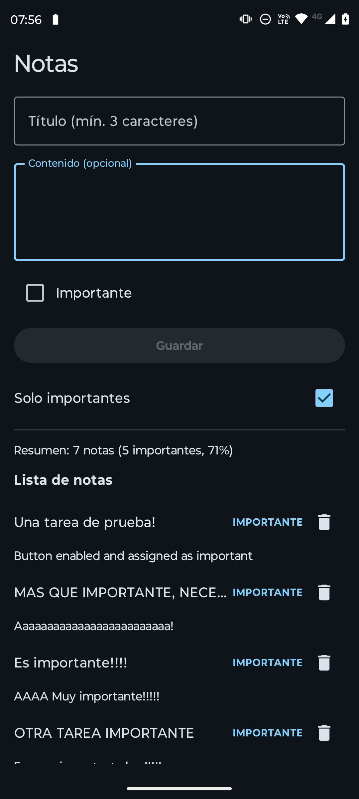

# Curso Testing Android - Notas & Prácticas de Testing

Proyecto práctico de desarrollo Android en Kotlin concebido exclusivamente con fines **educativos y de aprendizaje** para dominar el ecosistema de **Testing en Android**. 

No se trata de una aplicación comercial, sino de un entorno de pruebas diseñado para analizar, entender, practicar y comprobar diferentes estrategias de pruebas automatizadas (unitarias, de integración y de interfaz de usuario).

> [!NOTE]
> Este proyecto está basado en el excelente curso de desarrollo y testing en Android impartido por **Aris Guimerà**. Puedes explorar su contenido y perfil en su GitHub: [ArisGuimera](https://github.com/ArisGuimera).

## 🎯 Objetivo del Proyecto

Servir como base de estudio y laboratorio de pruebas para aprender a implementar:
- Pruebas unitarias de lógica de negocio y casos de uso (`UseCases`).
- Pruebas de ViewModels reactivos con corrutinas y `StateFlow` (utilizando *Turbine*).
- Pruebas de persistencia y bases de datos con *Room*.
- Pruebas de componentes de interfaz con *Jetpack Compose*.
- Mocking y aislamiento de dependencias con *MockK*.

## 🛠️ Stack Tecnológico

- **Lenguaje**: Kotlin
- **UI**: Jetpack Compose & Material 3
- **Arquitectura**: MVVM / Clean Architecture simplificada
- **Persistencia**: Room Database
- **Librerías de Testing**: JUnit 4, Kotlinx Coroutines Test, Turbine, MockK, Room Testing, Compose UI Test.

## 📂 Estructura del Proyecto

```text
com.canoezequiel7k.curso/
│
├── notes/
│   ├── data/        # Entidades, DAOs, Base de datos Room y Repositorio
│   ├── domain/      # Modelos, Casos de uso (UseCases) y contratos de Repositorio
│   └── ui/          # Pantallas en Jetpack Compose y ViewModel
│
└── ui/theme/        # Temas y estilos Material 3
```

## 📸 Capturas de Pantalla

A continuación se muestran algunas vistas de la aplicación organizadas lado a lado:

| Pantalla Principal (Notas) | Redacción de Nota |
| :---: | :---: |
|  |  |

| Mostrando Todas las Tareas | Mostrando Notas Importantes |
| :---: | :---: |
|  |  |

---

## 🧪 Suite de Testing Incluida

Este repositorio demuestra la aplicación práctica de pruebas en distintas capas:
1. **Dominio / Unitarias**: Validación de reglas de negocio (`ValidateTitleUseCaseTest`, etc.).
2. **Presentación / ViewModel**: Verificación de estados reactivos y eventos de usuario (`NotesViewModelTest`).
3. **Datos / Integración**: Pruebas de DAO y operaciones de base de datos con SQLite in-memory de Room.
